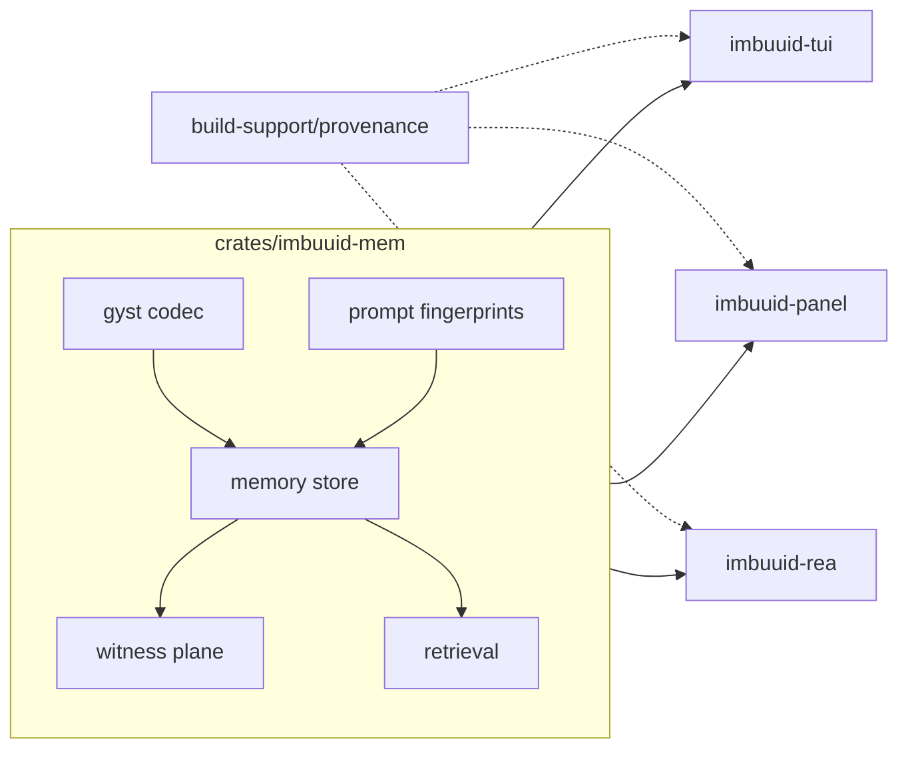

<!--
===============================================================================
file_id: SOM-DOC-10433-v1.0.0 (root index; see per-crate docs)
name: README.md
description: imbuuid-mem workspace root — UUID-substrate memory layer for AI agents
project_id: IMBUUID-MEM
category: doc
created: 2026-10-17
version: 1.0.0
===============================================================================
-->

# imbuuid-mem

UUID-substrate memory layer for AI agents — built in Rust, local-first.
Answers mem0 / hindsight / OpenViking with what they lack: identity-committed
UUID-keyed memories, content-hash dedup, Witness attestation, frequency-weighted
retrieval, delta streams, and Lloyd-Max quantization inside the identifier.

Crates: `imbuuid-mem` (core, SOM-DOC-10433), `imbuuid-tui` (SOM-DOC-10434),
`imbuuid-panel` + `imbuuid-rea` + provenance (SOM-DOC-10435).
**Nothing here is published. No pushes. Public release is founder-tapped.**
