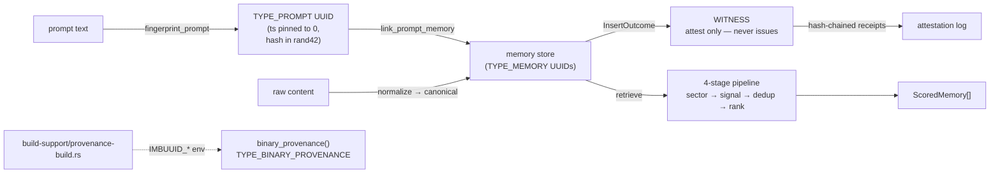

<!--
===============================================================================
file_id: SOM-DOC-10433-v1.0.0
name: ARCHITECTURE.md
description: imbuuid-mem core crate architecture — GYST codec, memory store,
             Witness attestation, prompt fingerprints, retrieval pipeline,
             build-time provenance
project_id: IMBUUID-MEM
category: doc
created: 2026-10-17
version: 1.0.0
===============================================================================
-->

# imbuuid-mem — Architecture

UUID-substrate memory layer for AI agents. Local-first: no network access at
runtime, ever. The storage/ingest answer is always the UUID DNA substrate —
every record is UUID-keyed and content-addressed.

## Data flow

## Modules

| Module | Role |
|---|---|
| `gyst` | GYST UUIDv8 v2.1 codec, byte-exact with `uuid_service_turboquant.py` / gyst.ts. Layout (MSB→LSB): `type(12)\|ns(12)\|ts(24)\|ver=8(4)\|fractal(12)\|var=0b10(2)\|prov(4)\|sig(16)\|rand(42)`. Provenance codes `PROV_*`, type codes `TYPE_*`. `0x400–0x403` (MEMORY/PROMPT/ATTESTATION/BINARY_PROVENANCE) are **provisional** codetable additions. |
| `memory` | Content-hash dedup. Canonical form `"{TYPE_MEMORY}\|{trim + collapse ws}"`; hash = low 42 bits of SHA-256(canonical) placed in the UUID rand42 field — a **documented codetable repurposing** that makes the memory UUID content-addressed. Encrypted mode: HMAC-SHA256(key, canonical) truncated to 42 bits, provenance forced to `PROV_ENCRYPTED (0xF)`; equality checkable only with the key. Dedup key = (content_hash, namespace). Persistence: whole-snapshot v0 (`<dir>/memories.json`, `{version:0, memories:[...]}`). |
| `witness` | **The Witness never issues.** No insert/mint method — structural. Attests only to `InsertOutcome`s produced elsewhere: `Created`→`FirstObservation`, `Duplicate`→`ReObservation`. Receipt = `sha256_hex(prev_receipt\|uuid\|kind\|count\|ts)`, genesis = `"GENESIS"`. `verify_chain()` recomputes every receipt. |
| `prompt` | Prompt fingerprinting: `TYPE_PROMPT` UUID, content hash in rand42, timestamp **pinned to 0** so identical text (+provenance) ⇒ identical UUID. `link_prompt_memory` binds a prompt fingerprint to a memory UUID. |
| `retrieval` | Four stages: (1) 12-bit sector pre-filter `(fractal_sector ^ qsector).count_ones() <= tolerance` (default 2) — a coarse grouping lens, never leaf addressing; (2) `sig_score = 1 - \|mem.signal - qsignal\|`, qsignal default 0.5 neutral (v0); (3) defensive dedup-collapse on content_hash, keep higher pre-score; (4) `score = 0.5*sector + 0.3*sig + 0.2*freq`, `freq = ln(1+count)/ln(1+max_count)` — re-observation is evidence. |
| `provenance` | Build-time binary provenance: reads `IMBUUID_PROVENANCE_UUID` / `IMBUUID_SOURCE_TREE_HASH` / `IMBUUID_BUILD_TIMESTAMP` / `IMBUUID_BUILDER` emitted by `build-support/provenance-build.rs` via this crate's `build.rs`. `None` when absent. The minter's encoder is independent of `gyst` by design (REA-provable). |

## Cross-cutting

- **Logging:** `tracing` spans/events on mint/insert/attest/retrieve with uuid/kind/count fields. No `println!` in library code.
- **Errors:** `thiserror` enums (`GystError`, `StoreError`).
- **Local-first:** no network crates; `getrandom` only for OS CSPRNG rand42.
- **Provisional:** `0x400–0x403` type codes, snapshot-v0 format, neutral query signal — all documented as v0, subject to codetable ratification.
