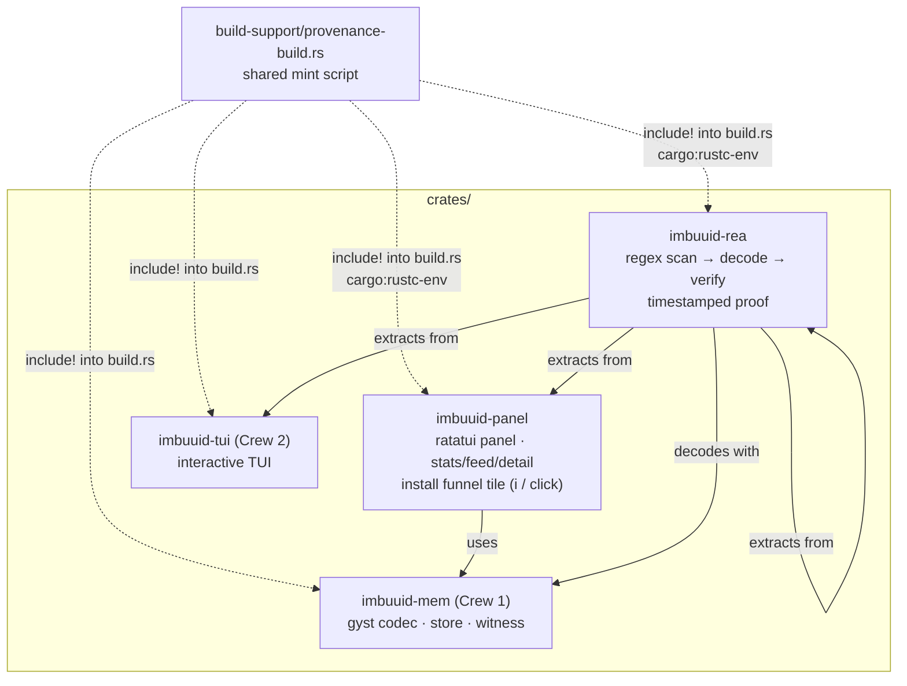
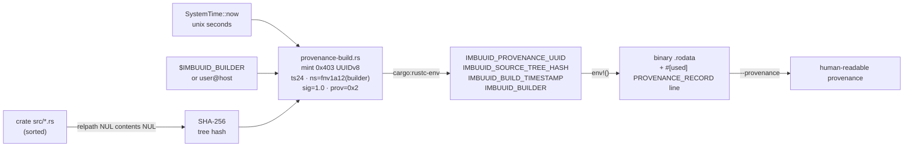
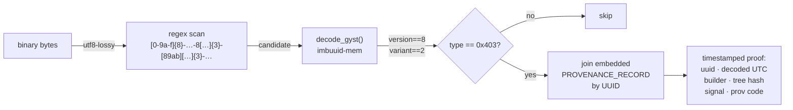
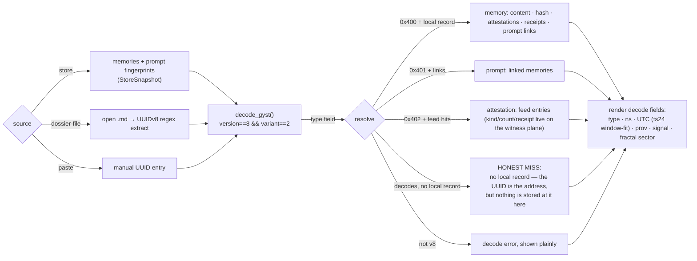
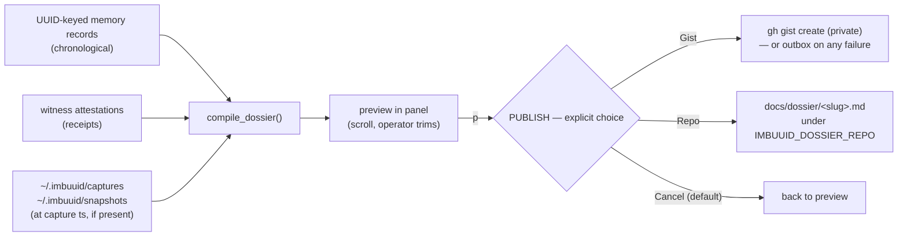

<!--
===============================================================================
file_id: SOM-DOC-10435-v1.0.0
name: PANEL-AND-PROVENANCE.md
description: imbuuid-panel (standalone memory panel) + imbuuid-rea (REA-loop
  provenance extractor) + build-time binary provenance integration — design,
  flows, and verification record. Crew 3 deliverable.
project_id: IMBUUID-MEM
category: doc
created: 2026-10-17
version: 1.0.0
===============================================================================
-->

# Panel, REA extractor & binary provenance (Crew 3)

`imbuuid-panel` — standalone memory panel app (ratatui + crossterm) in the
UUID panel-canvas aesthetic — and `imbuuid-rea` — the REA-loop provenance
extractor — plus the build-time provenance integration both share with
`imbuuid-tui`. All Rust 2021, crates.io deps only, nothing vendored.
**Nothing here is published. No pushes, no remotes — local only.**



## 1. Build-time provenance flow

Every binary mints a GYST UUIDv8 **type `0x403` (BINARY_PROVENANCE)** at
compile time, committing to `(source-tree SHA-256 || unix timestamp ||
builder identity)`. The mint lives in ONE shared script, included — never
forked — by each crate's `build.rs`.



Each crate's `build.rs` is exactly:

```rust
include!("../../build-support/provenance-build.rs");
```

with `[build-dependencies] sha2 = "0.11"` (see §5 — the spec's `sha2 = "1"`
does not exist on crates.io; Crew 1 independently pinned `0.10` for the
same reason; the `Digest` API used is identical).

The minted UUID is embedded two ways: (a) as `env!()` constants surfaced
by `--provenance` and by `imbuuid_mem::provenance::binary_provenance()`;
(b) as a byte-stable `#[used]` static record line
`IMBUUID_PROVENANCE_RECORD v=1 uuid=<uuid> builder=<b> tree=<sha> ts=<ts>`
that the extractor regex-joins back to the UUID hit. `#[used]` keeps it in
`.rodata` even though no Rust code reads it — the extractor is the reader.

## 2. REA extraction flow

`imbuuid-rea <path-to-binary>`: read bytes → regex-scan → decode →
verify → timestamped proof. The scan pattern bakes the UUIDv8 version
nibble (`8`) and the RFC 9562 variant bits (`[89ab]`) directly into the
regex, so **extraction simultaneously verifies UUIDv8 compliance** — a
non-v8 string cannot match. `decode_gyst` then re-checks
`version == 8 && variant == 2` as defense-in-depth, and only
`type_code == 0x403` hits are kept.



Exit codes: `0` with results · `1` with a clear message when no `0x403`
UUID is found · `2` on usage/I/O errors.

The 24-bit timestamp field wraps every 2²⁴ s (~194 days). The extractor
prints the raw field, a clearly-labelled nearest-window reconstruction
(exact for recently-minted binaries), and — when the embedded record is
present — the authoritative record timestamp plus a consistency check
between the two. For our own binaries the reconstruction and the record
agree to the second (verified 2026-10-17, §4).

## 3. Panel design

`imbuuid-panel` layout (120×40 reference):

- **Header KPI strip** — title, short provenance id, builder, clock.
- **Tile row** — STORE STATS (memories · attestations · dedup collapses ·
  namespaces) · NAMESPACES · **UUID BROWSER** (`b` / click) · **DOSSIER**
  (`d` / click) · **GET IMBUE install tile** (gold, prominent).
- **Witness attestation feed** — last N, newest-first, simulated live
  heartbeat tick every 3 s (documented; seam for the real witness stream).
- **Memories | memory detail** — arrow/j/k navigation, UUID · namespace ·
  signal · attestations · content-hash · summary.
- **Footer** — key hints + DEMO DATA tag.

### Hex-panel interpretation (honest terminal edition)

True hexagons cannot tile a character grid, so the UUID panel-canvas
aesthetic is interpreted, not imitated: (1) every tile is a hex cell,
marked by ⬡ glyphs in titles and honeycomb divider strips (⬡⬢⬡⬢)
between rows; (2) double-line borders carry the hex edge weight;
(3) gold `#C9A227` is reserved for the live/active/selected element, per
the estate brand law; (4) the header is a dense mono KPI strip in the
Activation-Command aesthetic. Mouse is supported (click the install tile,
click dialog buttons); `i` opens the funnel from the keyboard.

### Install funnel — hard rules

The GET IMBUE tile opens a confirmation dialog showing
`https://somacosf.gumroad.com/l/imbue` with three numbered steps. The
panel **NEVER downloads or installs anything silently** — on confirm it
only calls `open::that(url)` (browser), and if that fails it prints the
URL instead of failing silent. Installs are founder-tapped; this button
is a funnel, not an installer. All funnel events are traced to
`~/.imbuuid/panel.log` (file only — the TUI owns the terminal).

### Data seam

The panel renders through the `StoreSnapshot` trait. `InMemoryStore` is
the built-in source: deterministic seeded demo data (labelled DEMO) plus
a JSON snapshot loader (`--snapshot <path>` / `IMBUUID_PANEL_SNAPSHOT`).
Wiring Crew 1's live store in means implementing `StoreSnapshot` for
their store type — no UI changes needed. This is the documented open
integration point, not a stub: the panel is complete and testable
standalone.

## 4. Verification record (2026-10-17, final build vs Crew 1's real crate)

`cargo test -p imbuuid-mem -p imbuuid-panel -p imbuuid-rea`: **38 passed,
0 failed** (mem 19 unit + 3 integration · panel 10 · rea 6), exit 0, zero
warnings outside the intentional build-script mint announcements. (Crew 2's
`imbuuid-tui` does not yet compile against the real crate — 76 errors vs
their shim-guessed APIs — their binary below is from their earlier
shim-backed build; not my scope to fix, flagged for Crew 2.)

REA extraction against the three built binaries
(`target/debug/imbuuid-{tui,panel,rea}`), extractor exit 0 on all three:

| binary | provenance UUID | decoded UTC | builder | tree hash | record |
|---|---|---|---|---|---|
| `imbuuid-tui` | `403f40d3-b856-8000-8bff-fe174e82dfd8` | 2026-10-17 18:03:02 UTC | — (no record embedded by Crew 2) | — | UUID bits only |
| `imbuuid-panel` | `403f40d3-ba7b-8000-8bff-ff2f64a18dd3` | 2026-10-17 18:12:11 UTC | `unknown@` | `cac74483…5b17d47b` | full, consistency agrees |
| `imbuuid-rea` | `403f40d3-ba7c-8000-8bff-fc0b33d3894b` | 2026-10-17 18:12:12 UTC | `unknown@` | `1fac2bd4…17de3c48` | full, consistency agrees |
| `imbuuid-mem` rlib (transitive, inside panel+rea) | `403f40d3-b9d1-8000-8bff-fd8577c076ca` | 2026-10-17 18:09:21 UTC | — | — | UUID bits only |

Bonus finding: the extractor also recovers the **statically-linked
`imbuuid-mem` rlib's own provenance UUID** from inside the panel/rea
binaries (embedded via `option_env!` in Crew 1's `binary_provenance()`),
minted at 18:09:21 when the lib compiled — transitive provenance falls
out of the design for free.

All four share namespace `0xf40` (= `fnv1a12("imbuuid-build:unknown@")`)
and signal 1.0 / provenance code `0x2`, as minted. `builder=unknown@`
because `$USER`/hostname are empty in this container — honest fallback,
not a defect. Negative controls: `/bin/ls` → exit 1 "no provenance
found"; missing path → exit 2; no args → exit 2 with usage.

## 5. Deviations & assumptions (all flagged, none silent)

- **`sha2 = "1"` unresolvable.** No 1.x exists on crates.io (index tops
  at 0.11.1 as of 2026-10-17). Used `sha2 = "0.11"` in build-deps;
  Crew 1 independently hit the same wall and pinned `0.10`. The
  `Digest`/`Sha256` API the mint script needs is identical.
- **`binary_provenance()` returns `Option<BinaryProvenance>`** in Crew 1's
  crate (fields: `uuid`, `source_tree_hash`, `timestamp_sec`,
  `builder`; derives `Debug`). Both `--provenance` paths handle `None`.
- **`DecodedGyst.signal_normalized` is `f32`**, not `f64` — only
  formatted, never arithmetically assumed.
- **`decode_gyst` does not itself reject non-v8 input** (Crew 1 decodes
  any 32-hex); v8 compliance is enforced by the extractor's regex plus
  an explicit `version == 8 && variant == 2` check per hit.
- **Field names** (`type_code`, `timestamp_sec`, `provenance`, …) were
  taken from `test-vectors.json`; Crew 1's struct matches them exactly.
- **Parallel-crew collision:** Crew 2's dev shim (`/tmp/imbuuid-tui-dev`,
  package `imbuuid-mem`) collided in the shared lockfile with mine;
  mine was renamed to package `imbuuid-mem-crew3dev` (lib still
  `imbuuid_mem`) for dev builds. Both shims live in `/tmp`, never in
  the tree. Crew 2 also re-added `imbuuid-tui` to the workspace members
  mid-build, and their own backup pass overwrote my `Cargo.toml.bk` —
  the four-member list was reconstructed verbatim from the original
  read (generic backup names collide in a shared tree; use unique
  suffixes).
- **Crew 1 edited the shared mint script** (`//!` → `//`, E0753 fix,
  backup at `build-support/provenance-build.rs.bk-20261017`) at 17:53 —
  comment-only, no behavior change; my `build.rs` includes work
  unchanged.

## 6. Final integration state (2026-10-17 18:12 UTC)

- Workspace members: all four crates (restored; note §5 on the backup
  collision).
- `imbuuid-panel` / `imbuuid-rea` depend on `imbuuid-mem` via
  `path = "../imbuuid-mem"` — final form, no shim. The `/tmp` shim
  (`imbuuid-mem-crew3dev`) is dev-only and referenced nowhere in the tree.
- `cargo test -p imbuuid-mem -p imbuuid-panel -p imbuuid-rea`: 38 passed,
  0 failed, exit 0 — my two crates needed **zero code changes** against
  the real crate; the pinned API + test-vector field names matched
  exactly.
- Final numbers are in §4. Not BLOCKED-ON-CRATE.
- Open: live-store wiring for the panel (`StoreSnapshot` impl over
  Crew 1's store) and the real witness heartbeat replacing the 3 s
  simulated tick. Also: Crew 2's `imbuuid-tui` needs porting off its
  shim-guessed APIs (76 errors vs the real crate) before
  `cargo test --workspace` goes green.

## 7. UUID browser + contextual dossier (Crew 4, 2026-10-17)

`imbuuid-panel` gained two tiles in the panel chrome: **UUID BROWSER** (`b`)
and **DOSSIER** (`d`), wired into the same hex-canvas aesthetic (⬡ titles,
double-line borders, gold reserved for live/selected).

### 7.1 UUID browser — browse → decode → resolve → render

Doctrine: the UUID is the address; the panel resolves and renders. Three
UUID sources, one decode path (`imbuuid_mem::gyst::decode_gyst`), one
resolution per record kind:



Notes:

- The scan regex pins the v8 contract (`8` version nibble, `[89ab]`
  variant) — the same contract as the imbuuid-rea extractor; a non-v8
  string cannot enter from the dossier-file or store paths.
- Decoded fields: type code named via the contract consts (`MEMORY`,
  `PROMPT`, `ATTESTATION`, `BINARY_PROVENANCE`, …), namespace `0xNNN`,
  timestamp as human UTC with the 24-bit field explicitly labelled
  "ts24 window-fit" (~194-day wrap, nearest-window reconstruction —
  same convention as §2), provenance named (`CLI`, `AGENT`, …),
  signal, fractal sector `0xDDD` (depth · domain · generation).
- Store resolution goes through **defaulted `StoreSnapshot` trait
  methods** (`lookup_memory`, `attestations_for`, `prompt_fingerprints`,
  `prompt_links`) — existing implementors don't break; `InMemoryStore`
  also gained a `prompts: Vec<PromptRef>` field (serde-defaulted, so old
  JSON snapshots still load) seeded with four real TYPE_PROMPT
  fingerprints linked to memories.
- The seeded demo UUIDs are now **real TYPE_MEMORY v8 mints** via
  `encode_gyst` (namespace = `fnv1a12(label)`, ts = created, prov =
  CLI) — previously v8-shaped fixtures with a `0x540` type field, which
  the browser correctly refused to call MEMORY. Demo data stays
  deterministic; the honest-miss path is exercised by pasting any
  unknown-but-valid v8 UUID (`p` in the browser).

Keys in the browser: `Tab` cycles source · `↑↓` select · `Enter` resolves
· `p` pastes a UUID · `o` types a dossier `.md` path and loads it ·
`Esc` closes (or cancels the editor). Tiles are clickable like the
install tile.

### 7.2 Contextual dossier — compile → preview → publish (SOM-DOC-10439)

`d` compiles from the current scope and opens an in-panel preview:



Laws enforced in code, not comments:

- **No fabrication:** every dossier entry cites a record UUID; gaps >
  6 h render as explicit "gap of Nh" lines; unattested records are
  labelled UNATTESTED. `dossier_compiles_only_record_backed_entries`
  asserts every entry's UUID exists in the store.
- **Docs standard at publish:** the PUBLISH step verifies the Ghost
  Catalog header (`file_id:`) and a mermaid block exist, and refuses
  otherwise (`validate_dossier_payload`).
- **No silent network, ever:** Gist posts ONLY via `gh gist create`
  after the operator explicitly chose Gist in the dialog (Cancel is the
  default selection, keyboard and mouse). If `gh` is missing, fails, or
  `IMBUUID_DOSSIER_NO_GIST=1`, the exact payload goes to
  `~/.imbuuid/dossier-outbox/<slug>.md` (overridable via
  `IMBUUID_DOSSIER_OUTBOX`) and the dialog reports precisely what
  happened. Tests cover the outbox path and assert a Gist is never
  posted without the explicit confirm.
- Tracing: compile/publish events go to `~/.imbuuid/panel.log`.

New modules: `crates/imbuuid-panel/src/browser.rs` (source → decode →
resolve → render), `crates/imbuuid-panel/src/dossier.rs` (compile →
preview → publish). Both carry `// SOM-DOC-10435 (part)` Ghost headers.

### 7.3 Verification (2026-10-17, Crew 4)

`cargo test -p imbuuid-mem -p imbuuid-panel -p imbuuid-rea`: **64 passed,
0 failed** (mem 19 unit + 3 integration · panel 36 · rea 6), exit 0 —
only the intentional build-script provenance announcements on stderr.
(Crew 2's `imbuuid-tui` still does not compile against the real crate —
unchanged from §4/§6, not this crew's scope.)

Test coverage added: UUID extraction from a sample dossier `.md`
(incl. v4 rejection + dedupe), decode+resolve round-trip for a memory
record, the honest-miss case (decoded fields render, nothing invented),
prompt→linked-memories resolution, dossier compile containing only
record-backed entries (chronological, gaps as gaps), payload
header+mermaid validation (refusal cases), publish dialog defaulting to
Cancel with zero network, and the outbox path under
`IMBUUID_DOSSIER_NO_GIST=1`.

Open / stubbed: live-store wiring for the panel (`StoreSnapshot` impl
over Crew 1's store — the seam is ready) and the real witness heartbeat
replacing the 3 s simulated tick (unchanged from §6). The panel
snapshot plane carries no per-record observation count — the dossier
and browser show attestation counts + receipt lines instead, labelled
honestly.
