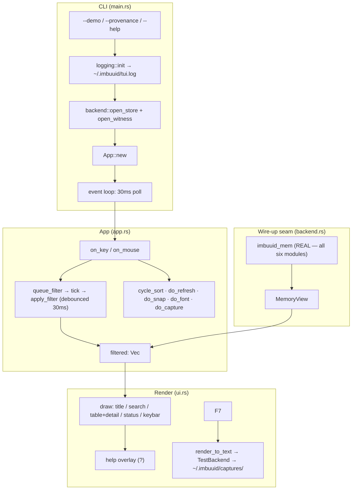
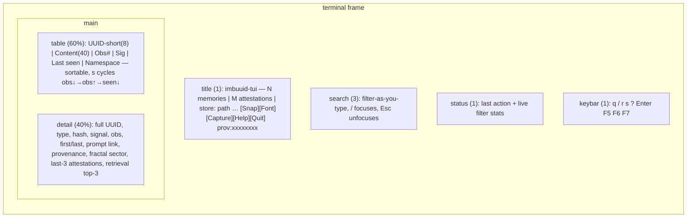

<!--
===============================================================================
file_id: SOM-DOC-10434-v1.0.0
name: docs/TUI.md
description: imbuuid-tui — portable standalone Rust TUI memory browser
  (ratatui + crossterm) over the imbuuid-mem store; layout, event loop,
  panel chrome, logging, wire-up seam, and build/test status
project_id: IMBUUID-MEM
category: doc
created: 2026-10-17
version: 1.0.0
===============================================================================
-->

# imbuuid-tui — TUI memory browser

Portable, standalone Rust TUI (ratatui + crossterm) over the `imbuuid-mem`
store. Local-first: the store lives at `~/.imbuuid/memories.json`
(created on first run); `imbuuid-tui --demo` seeds ~25 sample memories
across 2 namespaces (`ops`, `research`) for first-run feel. Edition 2021.

Crate: `crates/imbuuid-tui` (binary). Nothing here is published; no pushes.



## Layout



## Search UX

The bar is the late Python CCPC TUI's filter-as-you-type: every keystroke
re-filters the list, no enter-to-search. Keystrokes are coalesced through a
**30 ms debounce** (`app::DEBOUNCE`): the event loop polls at 30 ms, and
`App::tick()` applies the pending filter only once keystrokes have settled.
Matching is against **content substring + uuid-prefix + namespace**
(`App::matches_query`, pure and unit-tested). Each applied filter logs
`(query, result count, ms)` to `~/.imbuuid/tui.log`.

## Panel chrome (all honest — no dead buttons)

| Control | Key | Mouse | Effect |
|---|---|---|---|
| `[Snap]` | `F5` | title-bar click | view state + full store snapshot → `~/.imbuuid/snapshots/<unix-ts>.json`; status-bar confirm |
| `[Font]` | `F6` | title-bar click | cycle density compact ↔ comfortable (row height + detail verbosity); persisted to `~/.imbuuid/tui-config.json` |
| `[Capture]` | `F7` | title-bar click | re-render current frame to text via TestBackend → `~/.imbuuid/captures/<unix-ts>.txt`; confirm |
| `[Help]` | `?` | title-bar click | overlay with all keys (`?`/`Esc`/`q` closes) |
| `[Quit]` | `q` | title-bar click | exit (terminal state always restored) |

Table rows are mouse-clickable (selection); wheel scrolls list or detail pane
(in detail-scroll mode, toggled with `Enter`).

## Flags

- `--demo` — seed the 25-sample corpus (2 namespaces) when the store is empty.
- `--provenance` — print `IMBUUID_PROVENANCE_UUID`, `IMBUUID_SOURCE_TREE_HASH`,
  `IMBUUID_BUILD_TIMESTAMP`, `IMBUUID_BUILDER` (minted by
  `build-support/provenance-build.rs` via `build.rs`) and exit 0.

## Logging

`tracing_subscriber` → `~/.imbuuid/tui.log`, file only (the TUI owns the
screen; nothing logs to stdout). Logged: app start (provenance uuid, counts,
store path), every applied search (query, results, ms), snap/font/capture
actions, demo seeding, refresh, errors.

## Wire-up seam (`src/backend.rs`)

The ONLY module that touches `imbuuid_mem`. Uses the **real** `gyst` API
verbatim (Crew 1 landed `gyst.rs`: `fnv1a12`, `encode_gyst`, `mint_gyst`,
`decode_gyst`, `DecodedGyst`, `PROV_*`, `TYPE_*` — including
`TYPE_MEMORY=0x400`, `TYPE_ATTESTATION=0x402`, `TYPE_BINARY_PROVENANCE=0x403`).
Wired against Crew 1's real implementation (all six modules landed
2026-10-17). Key API facts the TUI depends on, documented in `backend.rs`:
`MemoryStore::open(Option<PathBuf>)` takes a directory (v0 snapshot at
`<dir>/memories.json`); records carry `namespace` as the u16 fnv1a12 hash
(the TUI keeps a label registry with hex fallback); the v0 `Witness` is
in-memory, so each session re-observes loaded records (ReObservation
attestations) to keep the title-bar count and detail receipts meaningful;
`fingerprint_prompt(text, provenance)` mints a ts-pinned TYPE_PROMPT UUID;
`retrieve()` returns `ScoredMemory{uuid, score, observation_count}`
(resolved via `store.get`); `binary_provenance()` reads the build-time env
the TUI's own `build.rs` mints — the title bar shows its 8-hex short form.

## Build / test

```sh
export PATH="$HOME/.cargo/bin:$PATH"
cd ~/workspace/imbuuid-mem
cargo build -p imbuuid-tui
cargo test -p imbuuid-tui   # 19 tests green (2026-10-17)
./target/debug/imbuuid-tui --demo
```

Deviations from the task brief (all flagged, none silent):
- `[build-dependencies] sha2 = "1"` → `sha2 = "0.10"`: no 1.x exists on
  crates.io (index tops at 0.11.x); the Digest API the provenance script
  needs is identical. (Crew 1 and Crew 3 hit the same wall and deviated
  independently to 0.10 / 0.11.)
- `crates/imbuuid-mem` was briefly excluded from workspace members while it
  didn't compile; all six modules have since landed and it builds. The TUI
  is a workspace member with `imbuuid-mem = { path = "../imbuuid-mem" }`.
  (Early dev ran against a private `/tmp` harness — discarded, never shipped.)
- One mechanical fix to Crew 1's manifest with `.bk` backup:
  `crates/imbuuid-mem/Cargo.toml` `[build-dependencies] sha2 = "1"` →
  `"0.10"` (their own `[dependencies]` already carried 0.10 with the same
  rationale).
